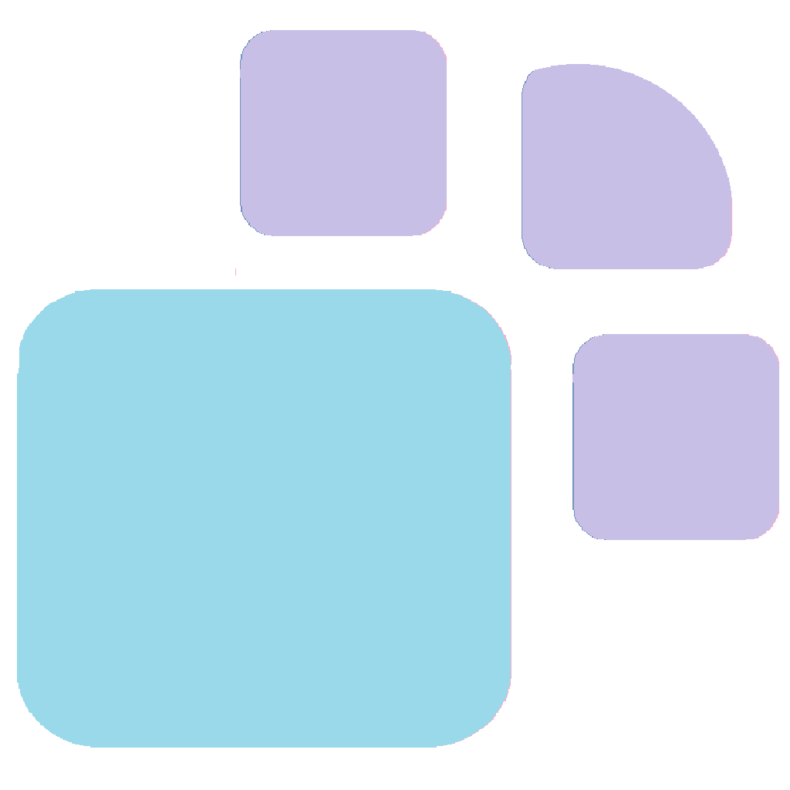

&nbsp;&nbsp;&nbsp;&nbsp;&nbsp;&nbsp;&nbsp;&nbsp;&nbsp;&nbsp;&nbsp;&nbsp;&nbsp;&nbsp;&nbsp;&nbsp;&nbsp;&nbsp;&nbsp;&nbsp;

# Paw - 桌面 AI Agent

Paw 是基于 Electron + Python 的桌面 AI Agent。后端是一个自研的 Agent 内核：一轮对话由"请求模型 → 流式输出 → 执行工具 → 结果回填"驱动，上下文预算与工具定义都在内核内统一管理。

## 特性

- **Agent 内核**：对话循环、流式输出、Function Calling、中断与恢复
- **工具链**：文件读写/编辑、目录搜索、内容检索、共享异步终端、Web 搜索与网页阅读、Todo 计划、Skill 扩展
- **上下文预算**：超出预算时按"折叠终端输出 → 截断旧工具结果 → 移除最旧轮次"逐级压缩，并显式提示用户
- **会话持久化**：SQLite 存储，增量写入，重启后完整恢复
- **多模式**：Default / Coding / Chatting / Learning，每种模式附加独立提示词
- **Skill 系统**：`~/.paw/skills/` 下按 SKILL.md 规范扩展能力，可从技能市场安装
- **记忆系统**（可选）：外部 Embedding 服务 + 本地 SQLite 向量检索，并带"回忆意图"前置判断

## 快速开始（开发环境）

```bash
# 1. 安装 Node 依赖
npm install

# 2. 构建 Python 环境（paw_env）
#    Paw 使用官方 Python embeddable 包，不依赖系统已安装的 Python：
#    a. 下载 https://www.python.org/ftp/python/3.13.5/python-3.13.5-embed-amd64.zip
#       解压到项目根目录的 paw_env/
#    b. 删除 paw_env/python313._pth（否则模块路径解析异常）
#    c. 安装 pip：在 paw_env/ 下执行 python.exe ..\get-pip.py --no-warn-script-location
#    d. 安装依赖：paw_env\python.exe -m pip install -r src\backend\requirements.txt

# 3. 启动
npm start
```

首次启动会在用户数据目录生成 `config.yaml`（来自 `src/backend/config.example.yaml`），在应用设置中填入 API 地址与密钥即可。

> **为什么用 embeddable 包而不是普通 venv？**
> 普通 venv 的 `python.exe` 依赖创建时的 Python 安装路径，打包到其它机器会直接崩溃。embeddable 包完全自包含，解压即用。

## 打包

```bash
npm run build:win    # 输出到 release/
```

打包产物内置完整 Python 环境与前端运行库，用户无需安装 Python。前端第三方库由 `scripts/vendor-assets.js` 从 `node_modules` 复制，因此离线也能渲染 Markdown 与代码高亮。

## 目录结构

```
Paw/
├── src/
│   ├── main/                    # Electron 主进程（窗口、生命周期、后端进程托管）
│   ├── renderer/                # 前端（原生 TypeScript + ESM）
│   │   ├── app.ts               # 装配入口
│   │   └── modules/             # 功能模块；markdown.ts 是唯一渲染入口
│   └── backend/
│       ├── paw.py               # 后端入口
│       ├── core/                # Agent 内核
│       │   ├── agent.py         # 一轮对话状态机
│       │   ├── tools.py         # 工具执行与超时
│       │   ├── catalog.py       # 工具目录（唯一 schema 来源）
│       │   ├── context.py       # 上下文预算与压缩
│       │   ├── storage.py       # SQLite 会话存储
│       │   ├── session.py       # 会话数据模型
│       │   ├── llm.py           # 模型客户端
│       │   ├── transport.py     # HTTP / WebSocket
│       │   ├── app.py           # 应用装配与命令解析
│       │   ├── config.py        # 配置读写
│       │   └── events.py        # 前后端事件名
│       ├── tools.py             # 工具实现
│       ├── memory.py            # 可选记忆系统
│       ├── terminal.py          # 共享异步终端
│       └── lib/                 # 技能市场、阈值校准
├── resources/                   # 图标、模板、静态资源
├── scripts/vendor-assets.js     # 复制前端第三方运行库
├── paw_env/                     # Python 环境（不提交）
└── dist/                        # 编译输出
```

## 内置指令

| 指令 | 说明 |
|------|------|
| `/new` | 开始新对话 |
| `/sessions` | 显示会话列表 |
| `/load <id>` | 恢复指定会话 |
| `/delete-session <id>` | 删除会话 |
| `/model` | 重新选择模型 |
| `/mode <name>` | 切换对话模式 |
| `/clear` | 清空当前会话消息 |
| `/memory` | 查看记忆列表 |
| `/reload-session` | 重新推送当前会话（编辑器保存后自动调用） |
| `/retry <n>` | 重试第 n 个用户轮次 |
| `/stop` | 停止当前生成 |

## 配置文件

`config.yaml` 位于用户数据目录（由 Electron 的 `PAW_CONFIG_DIR` 指定），字段见 `src/backend/config.example.yaml`。主要分组：`identity`、`api`、`memory`、`recall`、`terminal`、`web`、`context`、`workspace`、`theme`。设置界面保存后立即生效。

## License

Apache License 2.0
